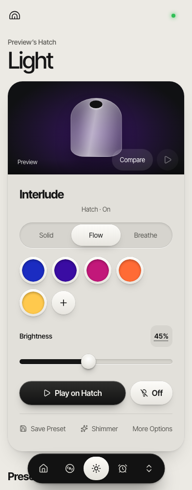

# Sound Room for Hatch

Your music, your light palettes, your wake-up routines—on your own Hatch.

Sound Room is a self-hosted web app for uploading MP3s and field recordings, playing Hatch sounds and favorites, creating animated light presets, and scheduling one-time or repeating alarms. Its phone-first interface works in a browser; the server keeps running when you close the page.

**Unofficial and independent of Hatch.** This is experimental community software that uses Hatch's cloud APIs. The current adapter requires an account with exactly one device reported as `restBaby`. Compatibility with other models and multi-device accounts is an extension opportunity, not an existing feature. See [Compatibility](docs/COMPATIBILITY.md) before connecting hardware.



*The demo uses a fake device; you can explore it before configuring credentials.*

## Try it without a Hatch

You need **Node.js 24.5+**, npm, and **ffmpeg** (including `ffprobe`) on your PATH. Check with `node --version` and `ffmpeg -version`. On macOS, `brew install node@24 ffmpeg` supplies these; on Ubuntu, install Node 24 and `sudo apt-get install ffmpeg`.

```sh
git clone https://github.com/josephanthonymatan/hatch-sound-room.git
cd hatch-sound-room
npm ci --ignore-scripts
npm run setup
npm run build
npm run preview
```

Open **http://127.0.0.1:4183**, then sign in with:

- Email: `preview@example.test`
- Password: `preview-only`

You're ready when the collection and Light screen appear. Try a built-in sound, paste a palette in **Light → More Options**, and create an alarm. Every command goes to a fake device, with disposable data; the preview uses no Hatch credentials and exits after 30 minutes. Press Ctrl-C to stop it.

## Connect your own Hatch

Each owner runs their own instance with their own account and storage. Sound Room is a single-owner controller, not a shared service for strangers to enter account credentials.

1. Check your device against [Compatibility](docs/COMPATIBILITY.md).
2. Follow [Setup](docs/SETUP.md) to configure credentials locally, generate independent secrets, and give the Hatch a reachable media URL.
3. When you're ready for real device control, start the server and perform the setup guide's light-only check.

A server `ready` response confirms the cloud connection. Verify actual sound and light on your device separately. Keep an independent wake-up alarm until you've tested unattended operation in your own environment.

## What you can do

| Sound | Light | Alarms |
| --- | --- | --- |
| Upload MP3/WAV files with titles, categories and tags | Pick a solid color or paste 2–32 hex colors | One-time or weekday repeats |
| Sync native favorites and model-specific sounds | Flow, breathe, drift, bloom and layered effects | Set volume, brightness and a light fade |
| Save a reference to the current native sound | Save custom presets in your browser | Edit, enable, disable and delete occurrences |
| Adjust volume by slider or exact entry | Run custom sequences on the server with the browser closed | Hold the Hatch's top control to silence on the tested unit |

The sample Bach recording is CC0 with [source attribution](media/README.md). Hatch catalog entries are references to provider-hosted assets; no Hatch recordings or premium access are included.

## Run it continuously

Use an always-on machine or a persistent container host. [Hosting](docs/HOSTING.md) covers Docker, a reusable Render Blueprint, HTTPS, disk persistence and backups. An attached disk and one server process are required for durable alarms and uploads. The host and home internet must remain available.

## Extend it

```sh
npm test
npm run build
```

These checks use fake devices and temporary databases. They do not contact your Hatch.

- [Contributing](CONTRIBUTING.md): development workflow, browser checks and what a useful pull request includes.
- [Architecture](docs/ARCHITECTURE.md): where to change device adapters, light effects, alarms, uploads and UI.
- [API](cloud/API.md): routes, authentication and payloads.
- [Security](SECURITY.md): secrets, recording URLs and reporting vulnerabilities.

The current legacy MQTT SDK has a [documented dependency advisory](SECURITY.md#known-dependency-advisory).

MIT-licensed code; third-party notices and media licenses remain in force. See [LICENSE](LICENSE) and [THIRD_PARTY_NOTICES.md](THIRD_PARTY_NOTICES.md).
